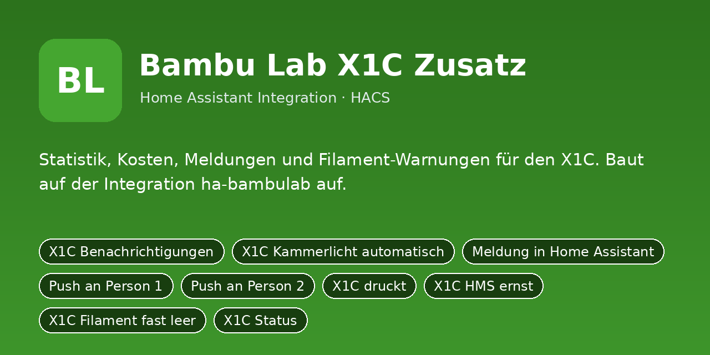

# Bambu Lab X1C Zusatz

Statistik, Kosten, Meldungen und Filament-Warnungen für den X1C. Baut auf der Integration ha-bambulab auf.

Python-Integration für Home Assistant (HACS). Sie ersetzt das bisherige YAML-Paket
`bambulab_x1c/packages/bambulab_x1c.yaml`: Einstellungen sind jetzt eigene Entitäten (Schalter, Zahlen, Auswahlfelder,
Uhrzeiten), die Logik läuft in Python statt in Automationen und Skripten.

## Installation

1. HACS → Integrationen → ⋮ → **Benutzerdefinierte Repositories** →
   `https://github.com/DerGnom1977/ha-bambulab-x1c-extras` als Kategorie **Integration** hinzufügen.
2. **Bambu Lab X1C Zusatz** installieren und Home Assistant neu starten.
3. Einstellungen → Geräte & Dienste → **Integration hinzufügen** → *Bambu Lab X1C Zusatz*.
4. Das Dashboard aus `dashboards/bambulab_x1c_extras_dashboard.yaml` anlegen (Raw-Konfigurationseditor).

Manuell: Ordner `custom_components/bambulab_x1c_extras` nach `/config/custom_components/` kopieren.

## Einrichtung

Beim Hinzufügen (und später über „Konfigurieren“) werden diese Angaben abgefragt:

- **Entitäts-Präfix der Bambu-Integration (z. B. x1c_<seriennummer>)** (`praefix`), Standard: `x1c_seriennummer`
- **Notify-Dienst Person 1** (`notify_person1`), Standard: `mobile_app_mein_handy`
- **Notify-Dienst Person 2** (`notify_person2`), Standard: `mobile_app_partner_handy`

## Was du anpassen musst

Alle Standardwerte oben sind **Platzhalter/Beispiele**. Passe sie beim Einrichten an dein System an:

- **Notify-Dienste** (`notify_person1`, `notify_person2`): Name deines Handy-Dienstes ohne `notify.`,
  z. B. `mobile_app_mein_handy` → bei dir `mobile_app_<gerätename>` (Entwicklerwerkzeuge → Aktionen → „notify“).
  „Person 1/Person 2“ sind frei; die Schalter *Push an Person 1/2* schalten die jeweilige Meldung.
- **Entitäten** (`sensor.…`, `camera.…`, `person.…`, `todo.…` usw.): auf die echten Entitäts-IDs aus
  Einstellungen → Geräte & Dienste → Entitäten ändern. Leere Felder sind Pflicht, wenn die Funktion genutzt wird.
- **Dashboard** (`dashboards/bambulab_x1c_extras_dashboard.yaml`): enthält Entitäts-IDs der Integration; wenn du Namen
  oder Räume änderst, dort per Suchen/Ersetzen nachziehen.
- Später jederzeit unter Einstellungen → Geräte & Dienste → *Bambu Lab X1C Zusatz* → **Konfigurieren** änderbar.

## Umstieg vom YAML-Paket

1. Das alte Paket `bambulab_x1c/packages/bambulab_x1c.yaml` (und sein Dashboard) aus `/config/packages/` entfernen
   und Home Assistant neu starten, damit Helfer, Automationen und Skripte nicht doppelt laufen.
2. Integration einrichten. Neue Entitäten haben dieselben Namen wie die alten Helfer, nur mit
   anderer Domain, z. B. `input_boolean.xyz` wird `switch.xyz`, `input_number.xyz` wird `number.xyz`,
   `input_select.xyz` wird `select.xyz`, `input_datetime.xyz` wird `time.xyz`.
3. Eigene Automationen und Dashboards, die alte Entitäten nutzen, entsprechend anpassen.
4. Die alten Standardwerte sind schon eingebaut, die Einstellungen bleiben nach Neustarts erhalten.

## Entitäten

### Schalter

- `switch.x1c_benachrichtigungen` – X1C Benachrichtigungen
- `switch.x1c_licht_automatik` – X1C Kammerlicht automatisch
- `switch.x1c_ziel_ha` – Meldung in Home Assistant
- `switch.x1c_ziel_person1` – Push an Person 1
- `switch.x1c_ziel_person2` – Push an Person 2

### Zahlenwerte

- `number.x1c_filamentpreis` – X1C Filamentpreis
- `number.x1c_strompreis` – X1C Strompreis
- `number.x1c_leistung` – X1C mittlere Leistung beim Drucken
- `number.x1c_ams_feuchte_grenze` – X1C AMS Feuchte-Grenzwert
- `number.x1c_filament_rest_grenze` – X1C Filament-Restwarnung
- `number.x1c_filament_gesamt` – X1C Filament verbraucht gesamt

### Sensoren

- `sensor.x1c_status` – X1C Status
- `sensor.x1c_restzeit_minuten` – X1C Restzeit Minuten
- `sensor.x1c_restzeit` – X1C Restzeit
- `sensor.x1c_fertig_um` – X1C Fertig um
- `sensor.x1c_schicht` – X1C Schicht
- `sensor.x1c_druckdauer_gesamt` – X1C Druckdauer gesamt
- `sensor.x1c_filamentkosten_druck` – X1C Filamentkosten Druck
- `sensor.x1c_stromkosten_druck` – X1C Stromkosten Druck
- `sensor.x1c_kosten_druck_gesamt` – X1C Kosten Druck gesamt
- `sensor.x1c_erfolgsquote` – X1C Erfolgsquote
- `sensor.x1c_aktives_filament` – X1C Aktives Filament
- `sensor.x1c_ams_belegt` – X1C AMS belegt
- `sensor.x1c_hms_meldungen` – X1C HMS Meldungen
- `sensor.x1c_druckzeit_heute` – X1C Druckzeit heute
- `sensor.x1c_druckzeit_7_tage` – X1C Druckzeit 7 Tage
- `sensor.x1c_druckzeit_30_tage` – X1C Druckzeit 30 Tage
- `sensor.x1c_drucke_erfolgreich` – X1C Drucke erfolgreich
- `sensor.x1c_drucke_fehlgeschlagen` – X1C Drucke fehlgeschlagen
- `sensor.x1c_letzter_druck` – X1C Letzter Druck
- `sensor.x1c_letzter_druck_ende` – X1C Letzter Druck beendet
- `sensor.x1c_entitaeten_check` – X1C Entitäten-Check

### Binärsensoren

- `binary_sensor.x1c_druckt` – X1C druckt
- `binary_sensor.x1c_hms_ernst` – X1C HMS ernst
- `binary_sensor.x1c_filament_fast_leer` – X1C Filament fast leer

### Knöpfe

- `button.x1c_test` – Testmeldung senden
- `button.x1c_zaehler_zuruecksetzen` – Zähler zurücksetzen
- `button.x1c_standardwerte` – Standardwerte setzen

## Hinweis

Die Integration wurde aus dem bestehenden YAML-Paket portiert und ist noch nicht in einer laufenden
Home-Assistant-Instanz getestet. Bitte beim ersten Einsatz die Logbuch-/Protokoll-Meldungen
(`custom_components.bambulab_x1c_extras`) im Blick behalten.
